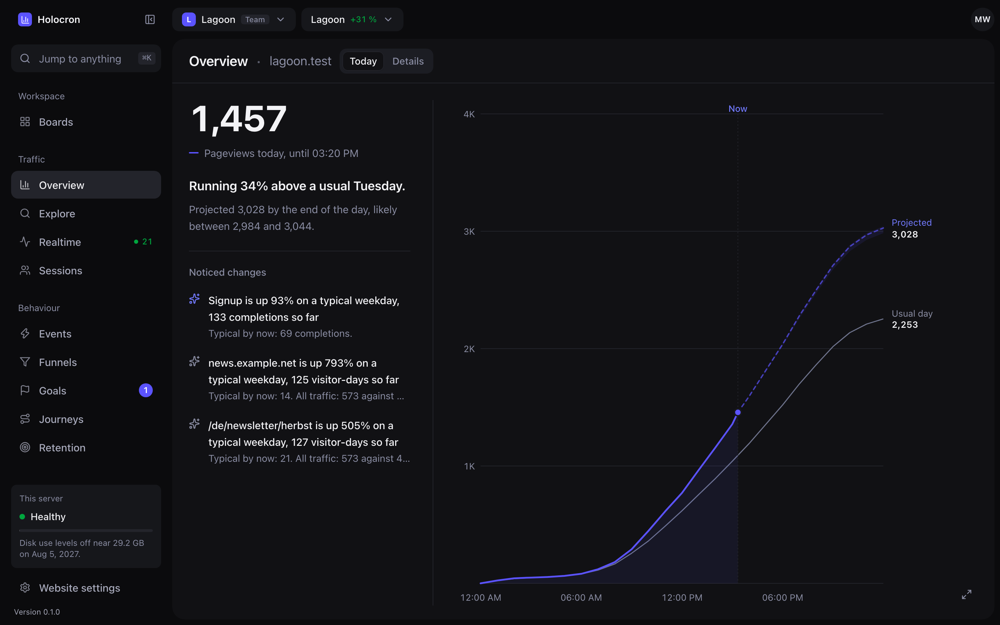
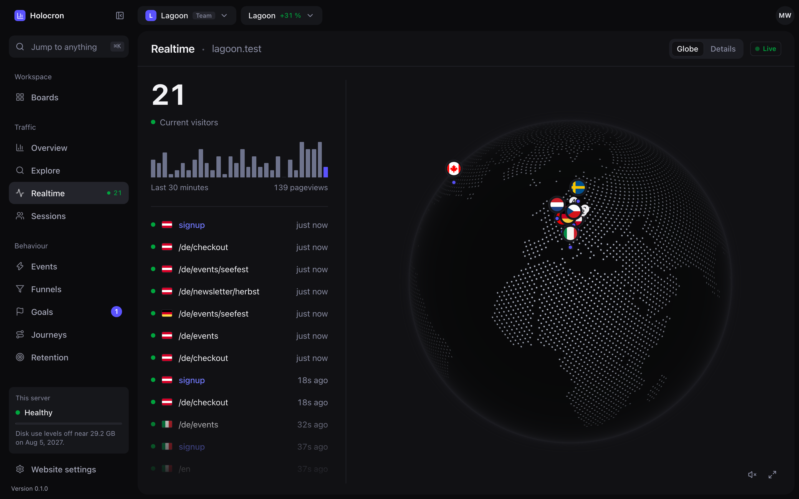
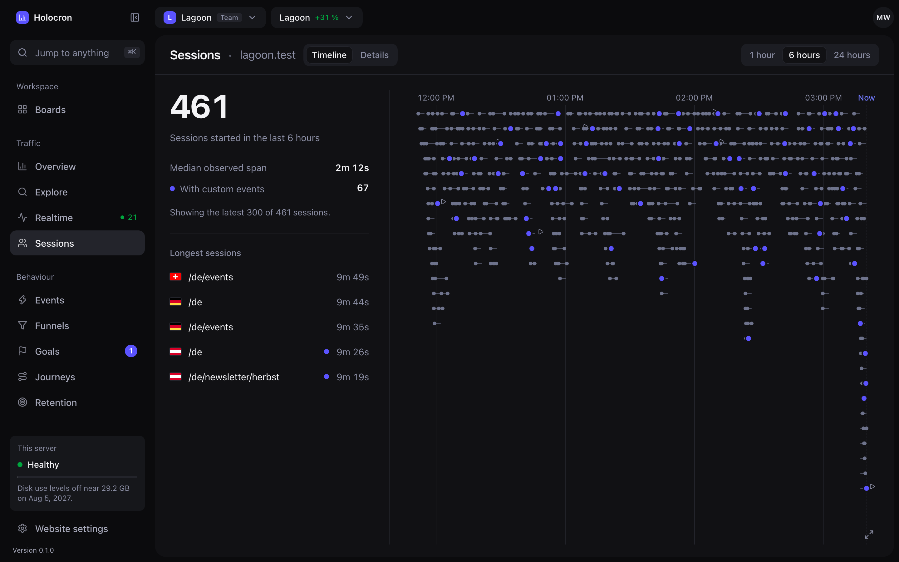
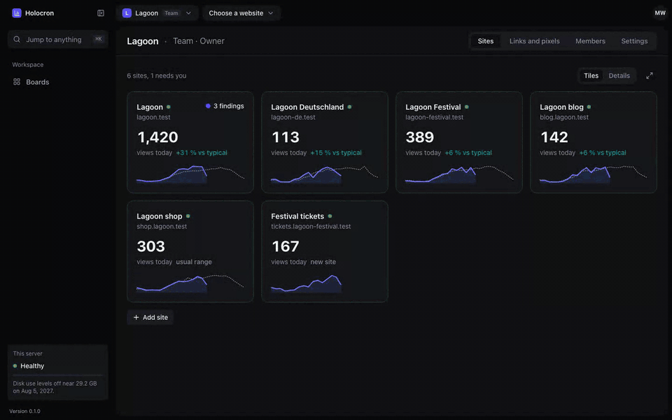
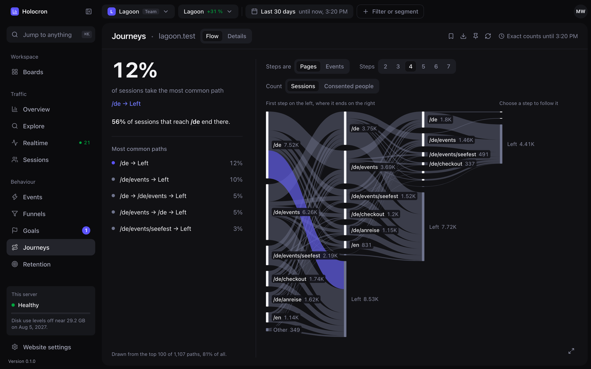
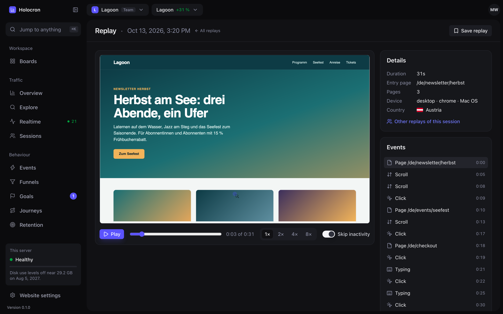

<div align="center">

# Holocron

**Self-hosted web analytics for people who run Umami today.**

Keep your Umami tracker and your history, and get the analysis Umami doesn't have: today against a typical weekday, filters that nest, cohorts of consented visitors, replays with tight limits. One Rust binary and one data directory. No Postgres, no Node.

[](LICENSE)
[](CHANGELOG.md)
[](https://github.com/coderscantina/holocron/actions/workflows/ci.yml)
[](https://github.com/coderscantina/holocron/releases)

[Quickstart](#quickstart) · [Guide](docs/guide/README.md) · [Comparison](#how-it-compares) · [Sizing](#sizing) · [Changelog](CHANGELOG.md)



</div>

> [!NOTE]
> Holocron is in beta. Every feature below is built, and you should still expect rough edges. Releases use calendar versions, e.g. `v26.10.19-1a2b3c4`.

## Why Holocron

- **Your tracker and history come along.** Holocron serves the unchanged Umami 3.4.0 tracker and recorder, and website IDs stay the same, so a cutover is a host name change. It imports Umami 3.4.0 on PostgreSQL and 2.20.2 on MySQL with a read-only user, then proves the result with a reconciliation manifest. Passwords and authenticator apps keep working.
- **Answers, not just charts.** The overview tells you how today compares with a normal weekday, where the day is heading, and which few changes explain the difference. Explore takes nested AND/OR filters on typed event properties, splits by any field, and keeps the whole state in the URL, saved views, boards and share links.
- **Less to run.** One process with embedded SQLite and DuckDB replaces Umami's Node app and its PostgreSQL server. An event is acknowledged only after it is on disk. Backup, restore and upgrade are commands that verify their own result, and backups run while collection goes on.

## Features

- **Overview.** Today's pace against a typical weekday, a labelled projection for the rest of the day, and findings computed in the background.
- **Realtime.** Active visitors on a globe and a live event list.
- **Explore.** Measures, fields, grouped AND/OR filters, property filters, splits, period comparison, saved views, boards and annotations. Export as CSV or JSON.
- **Reports.** Events and typed properties, sessions with a timeline, funnels, journeys, goals, campaigns, attribution, retention cohorts, revenue per currency and Core Web Vitals.
- **Replays and heatmaps.** Off until a site turns them on. Strict masking, sampling, element and page exclusions, a storage cap, and playback in a frame that can't load anything.
- **Privacy.** No cookies. Anonymous visitors get a pseudonym from a key that changes daily per site and is deleted a day later. IP addresses are never stored. Persistent profiles only for visitors who consented.
- **Teams and access.** Workspaces with owner, admin, member and viewer roles. TOTP two-factor sign-in with recovery codes, scoped API keys, and share links with limits and an expiry. Install admins read a site's analytics only as members of its workspace.
- **Umami import.** Accounts, teams, sites, events, replays, heatmaps, segments, reports and share links, with a dry run, resume after interruption and a manifest.
- **Operations.** `backup`, `restore`, `upgrade`, `retention`, `erase-profile` and `diagnostics` commands, `/health` and `/health/ready` endpoints, and a Docker image for amd64 and arm64.
- **Languages.** The dashboard ships in English and German.

<table>
  <tr>
    <td width="50%">
      
    </td>
    <td width="50%">
      
    </td>
  </tr>
</table>



## Quickstart

You need Docker and a domain pointing at your server. The compose file binds to `127.0.0.1:8080`, so put a reverse proxy with TLS in front of it ([Caddy example](deploy/Caddyfile)).

```bash
curl -O https://raw.githubusercontent.com/coderscantina/holocron/main/deploy/docker-compose.yml
export HOLOCRON_PUBLIC_URL=https://analytics.example.com
docker compose up -d
docker compose logs holocron | grep 'setup token'
```

Open your public URL and enter the setup token. The wizard creates your admin and your first site, shows its tracking code and turns green when the first pageview arrives. Then set up two-factor sign-in under Account.

**Already on Umami?** Pick Import from Umami in the wizard and paste the URL of a read-only database user; it previews, imports and reconciles in the browser ([guide](docs/guide/umami-migration.md)). From the shell instead, on a stopped server with a data directory without sites, start with the dry run, which only reads:

```bash
docker compose stop
export HOLOCRON_IMPORT_SOURCE='postgres://holocron_import:<password>@db.internal:5432/umami'
docker compose run --rm -e HOLOCRON_IMPORT_SOURCE holocron import inspect --timezone Europe/Vienna
docker compose run --rm -e HOLOCRON_IMPORT_SOURCE holocron import run --timezone Europe/Vienna > manifest.json
docker compose up -d
```

Then point your tracker's script tags at the new host. Website IDs don't change:

```html
<script defer src="https://analytics.example.com/script.js" data-website-id="..."></script>
```

The [guide](docs/guide/README.md) covers [installation](docs/guide/install.md), [configuration](docs/guide/configuration.md), [the Umami migration](docs/guide/umami-migration.md), [tracking](docs/guide/tracking.md), [teams and access](docs/guide/teams-and-access.md) and [operations](docs/guide/operations.md).

<table>
  <tr>
    <td width="50%">
      
    </td>
    <td width="50%">
      
    </td>
  </tr>
</table>

## How it compares

Holocron is built for people moving off Umami. Here's where it stands next to the tools people usually self-host, as of October 2026, for their self-hosted editions.

|                                 | Holocron                               | Umami 3.x                            | Plausible CE                        | Matomo On-Premise                        |
| ------------------------------- | -------------------------------------- | ------------------------------------ | ----------------------------------- | ---------------------------------------- |
| Cookies                         | None                                   | None                                 | None                                | First-party by default, can be turned off |
| Visitor identity                | Key per site and day, deleted after a day | Hash of IP and browser with a monthly salt | Hash with a daily salt         | Cookie, or a config hash without cookies |
| Location                        | CDN headers, then a GeoIP database     | GeoIP database                       | GeoIP database                      | GeoIP database                           |
| Today against a typical weekday | Yes, with a projection                 | No                                   | No                                  | No                                       |
| Nested AND/OR filters           | Yes                                    | Flat, match all or any               | No                                  | Segment editor                           |
| Funnels, journeys, goals        | Yes                                    | Yes                                  | Goals only, funnels are Cloud-only  | Goals, funnels as a paid plugin          |
| Revenue                         | Per currency                           | Yes                                  | Cloud-only                          | Ecommerce                                |
| Retention cohorts               | Consented profiles only                | Yes                                  | No                                  | Paid plugin                              |
| Replays and heatmaps            | Yes, opt-in per site                   | Yes                                  | No                                  | Paid plugin                              |
| Teams and roles                 | Workspaces, four roles                 | Teams, roles                         | Site members, roles                 | Users with per-site access               |
| Share links                     | Limited fields and span, expire        | Public, by section                   | Public or with a password           | Anonymous view access                    |
| Two-factor sign-in              | TOTP                                   | TOTP                                 | TOTP                                | TOTP                                     |
| Umami import                    | Yes, reconciled                        | n/a                                  | No                                  | No                                       |
| What you run                    | One binary, embedded SQLite and DuckDB | Node.js app and PostgreSQL           | Elixir app, PostgreSQL and ClickHouse | PHP app and MySQL or MariaDB           |
| Around since                    | Beta, 2026                             | 2020                                 | 2019                                | 2007, as Piwik                           |
| License                         | MIT                                    | MIT                                  | AGPL-3.0                            | GPL-3.0                                  |

Holocron has gaps the others don't. Without a CDN in front, locations need a GeoIP database you download or bring. It runs on one server only. It sends no email, so invitations and password resets are links an admin passes on. And it is new: the others have years of production use behind them.

Pick Umami if it does what you need: it is the proven tool for this tracker, with the larger community. Pick Plausible CE if you want one simple dashboard and don't need funnels or revenue. Pick Matomo if you want the broadest feature set and a plugin market, and accept PHP and paid plugins for replays and funnels. Pick Holocron if you run Umami, want deeper analysis and fewer services to run, and can live with a beta.

## Sizing

Holocron is built and budgeted for one reference host: **2 vCPUs, 4 GiB of memory and a local SSD**. Pick the preset for your host with `--budget small|standard|large`. Standard gives the analytics engine 2 threads and 1 GiB of memory. Only the standard host is a promise, and it is not measured on the reference host yet.

What is measured, on a laptop VM limited to 2 CPUs and 4 GiB ([decision 0008](docs/decisions/0008-storage-engine-and-budgets.md)):

- 124 million records across several sites load through the normal collection path, and every report completes.
- A burst of 500 events a second with two people using the dashboard: acknowledgement p95 90 ms, visible in reports p95 0.8 s, nothing refused.
- 30-day reports on a mid-sized site: p95 0.2 to 0.4 s. On the largest site, with 57 million events a year, some 30-day reports take up to 5.6 s and some annual ones up to 24 s, against targets of 2 s and 10 s.
- Peak memory 3.8 GB of the 4 GiB, with no out-of-memory kill.

That puts the limit near **20 million events a year for your largest site**. Reports read one site at a time, so the largest site sets latency, while disk follows all sites together.

| Tier | Host | Largest site, events a year | All sites, retained events | Disk |
| --- | --- | --- | --- | --- |
| Small | 1 vCPU, 2 GiB | about 8M, estimated | 40M | 25 GiB |
| Standard | 2 vCPU, 4 GiB | about 20M, from two measured scales | 125M, measured | 50 GiB |
| Large | 4 vCPU, 8 GiB | about 35M, estimated | 250M | 100 GiB |

Small and large are estimates, and their presets are not measured. Not measured at all: the reference host itself, cold caches, power loss, a 24-hour soak, and multi-year ranges. Retention defaults to 1 year, but an import keeps the whole history by default, and years of history cost disk and query time beyond these numbers.

## Tech stack

- **Server:** Rust with Axum, SQLite through SQLx, embedded DuckDB for analytics
- **Dashboard:** Vue 3, Vite and Tailwind 4, built with Bun, served by the same binary
- **Tracker:** the unchanged Umami 3.4.0 `script.js` and `recorder.js`, pinned and embedded
- **API:** typed end to end, with an OpenAPI description in [`crates/protocol/openapi.json`](crates/protocol/openapi.json)

## Contributing

Bug reports and pull requests are welcome. Start with the [contributing guide](CONTRIBUTING.md). It covers the dev setup, the gitmoji commit format and the checks CI runs. The [development docs](docs/README.md) hold the design decisions and evidence behind every feature.

- [GitHub Discussions](https://github.com/coderscantina/holocron/discussions) for questions and ideas
- [GitHub Issues](https://github.com/coderscantina/holocron/issues/new/choose) for bugs and feature requests

Please report vulnerabilities privately, as described in the [security policy](SECURITY.md).

## License

Holocron is licensed under the [MIT license](LICENSE).

## Acknowledgements

- The [Umami](https://github.com/umami-software/umami) team and contributors. Holocron serves their tracker and recorder unchanged, imports their data, and would not exist without them
- [rrweb](https://github.com/rrweb-io/rrweb), which records and plays back replays
- The people behind the Rust and Vue libraries Holocron is built on
